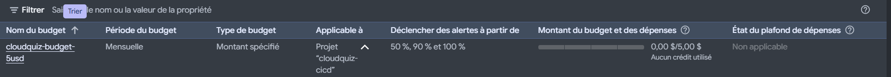
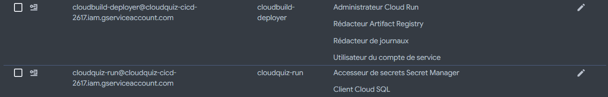
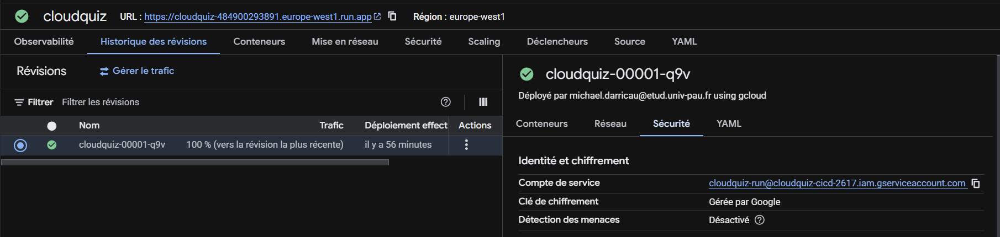
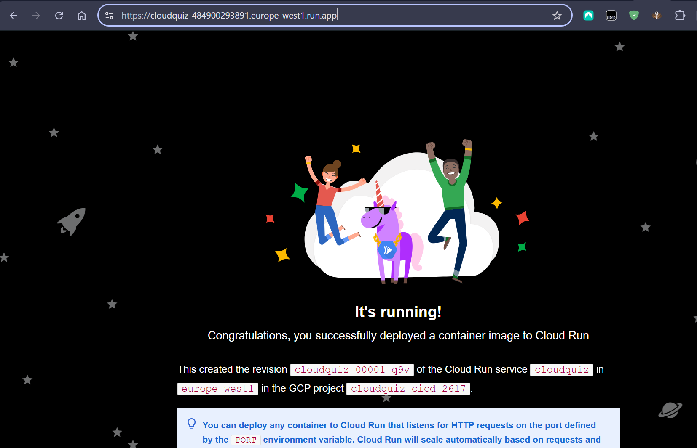
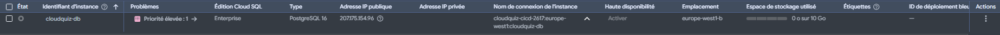

# Infrastructure GCP de CloudQuiz

Documentation de la partie infrastructure. Aucun secret n'est écrit dans ce document ni dans le dépôt : ni mot de passe, ni valeur du secret `database-url`, ni clé JSON.

## 1. Paramètres du projet

| Ressource | Valeur |
|---|---|
| Projet GCP (nom) | `cloudquiz-cicd` |
| Projet GCP (ID) | `cloudquiz-cicd-2617` |
| Numéro du projet | `484900293891` |
| Ressource parente | Aucune organisation |
| Région (partout) | `europe-west1` |
| Facturation | Compte de facturation des établissements d'enseignement (crédits Google Cloud) |
| Dépôt Artifact Registry | `cloudquiz` (format Docker) |
| Service Cloud Run | `cloudquiz` |
| Compte de service du pipeline | `cloudbuild-deployer` |
| Compte de service de l'application | `cloudquiz-run` |
| Instance Cloud SQL | `cloudquiz-db` (PostgreSQL 16, édition Enterprise) |
| Base / utilisateur | `cloudquiz` / `cloudquiz_app` |
| Secret | `database-url` |
| Branche Git | `infra/gcp-setup` |

### Budget et alertes

- Budget : `cloudquiz-budget-5usd`, **5 USD par mois**, limité au projet `cloudquiz-cicd`.
- Choix de l'équipe : 5 USD au lieu des 10 USD prévus, pour être alertés plus tôt et respecter le quota collectif des différents groupes.
- Seuils d'alerte : **50 %, 90 % et 100 %**, déclenchés sur les coûts réels.
- Remises et crédits promotionnels **exclus** du calcul : le budget suit la consommation réelle, même quand elle est couverte par les crédits.
- Type « alertes uniquement » : un budget Google Cloud prévient par e-mail mais **ne bloque pas** les dépenses. Le plafond de dépenses n'a pas été activé, car il mettrait les services en pause pendant une démonstration.
- Vérification : `gcloud billing projects describe cloudquiz-cicd-2617` affiche `billingEnabled: true`.



## 2. API activées

`run`, `cloudbuild`, `artifactregistry`, `sqladmin`, `secretmanager` et `iam` (`.googleapis.com`). Secret Manager sert aussi à la connexion GitHub de Cloud Build.

Vérification : `gcloud services list --enabled` contient ces six services.

## 3. Dépôt d'images Artifact Registry

- Dépôt `cloudquiz`, format Docker, région `europe-west1`.
- Chemin des images : `europe-west1-docker.pkg.dev/cloudquiz-cicd-2617/cloudquiz`.
- Règle de nettoyage (`scripts/cleanup-policy.json`) : les **10 images les plus récentes** sont toujours gardées, les autres sont **supprimées après 7 jours**. Le stockage reste ainsi minimal.
- Analyse des vulnérabilités désactivée (payante, non demandée).


## 4. Comptes de service et rôles (moindre privilège)

| Compte | Utilisé par | Rôles | Pourquoi |
|---|---|---|---|
| `cloudbuild-deployer@cloudquiz-cicd-2617.iam.gserviceaccount.com` | Cloud Build (pipeline) | `roles/run.admin`, `roles/iam.serviceAccountUser`, `roles/artifactregistry.writer`, `roles/logging.logWriter` | Déployer une nouvelle révision Cloud Run, lancer l'application avec le compte `cloudquiz-run`, publier les images, écrire les logs du build |
| `cloudquiz-run@cloudquiz-cicd-2617.iam.gserviceaccount.com` | Cloud Run (application) | `roles/cloudsql.client`, `roles/secretmanager.secretAccessor` | Se connecter à la base et lire l'URL de connexion, rien d'autre |

- **Aucune clé JSON** n'a été créée pour ces comptes : Cloud Build et Cloud Run les utilisent directement. Une clé publiée par erreur sur GitHub donnerait accès au projet.
- Vérification : `gcloud iam service-accounts keys list --iam-account=<compte> --managed-by=user` renvoie `Listed 0 items` pour les deux comptes.
- Le compte « Default compute service account » (`484900293891-compute@developer.gserviceaccount.com`) est créé automatiquement par Google à l'activation des API. Il n'est utilisé ni par le pipeline ni par l'application.

Droits de l'équipe sur le projet : Seydou est Propriétaire (il doit relier GitHub à Cloud Build et créer le déclencheur, ce qui demande de modifier des droits IAM). Les autres membres sont Éditeurs. Le professeur sera ajouté en Lecteur à la fin du projet.



## 5. Premier déploiement Cloud Run

- Service `cloudquiz`, région `europe-west1`, déployé avec l'image de test de Google (`us-docker.pkg.dev/cloudrun/container/hello`). Le pipeline la remplace ensuite par CloudQuiz, sur la même URL.
- Compte d'exécution : `cloudquiz-run`.
- Accès public (`--allow-unauthenticated`), `--min-instances=0` (aucun coût sans trafic), `--max-instances=2` (coût plafonné).
- URL : https://cloudquiz-484900293891.europe-west1.run.app (aussi https://cloudquiz-7urclgms6a-ew.a.run.app).





## 6. Cloud SQL PostgreSQL et secret

### Instance

| Paramètre | Valeur | Raison |
|---|---|---|
| Instance | `cloudquiz-db` | Nom attendu par le pipeline |
| Version | PostgreSQL 16 | Version demandée par l'application |
| Édition | Enterprise (pas Enterprise Plus) | Beaucoup moins chère |
| Machine | `db-f1-micro` (cœur partagé) | Plus petite configuration disponible |
| Disponibilité | Une seule zone (`europe-west1-b`), haute disponibilité désactivée | Pas de copie dans une seconde zone : coût divisé par deux |
| Stockage | 10 Go | Minimum |
| Sauvegardes automatiques | Désactivées | Choix assumé : données non critiques (scores de quiz), stockage supplémentaire facturé |
| Réseaux autorisés | Aucun | L'application passe par le connecteur Cloud SQL, contrôlé par IAM (rôle `cloudsql.client` de `cloudquiz-run`) |

Nom de connexion : `cloudquiz-cicd-2617:europe-west1:cloudquiz-db`.

### Base, utilisateur et secret

- Base `cloudquiz`, utilisateur `cloudquiz_app`.
- Le mot de passe est généré dans Cloud Shell par `openssl rand -hex 24` (hexadécimal : aucun caractère spécial qui casserait l'URL). Il n'est **jamais affiché, écrit dans un fichier ou commité** : il n'existe que dans le secret.
- Le secret `database-url` (Secret Manager, réplication automatique) contient l'URL de connexion complète, au format `postgres://cloudquiz_app:<mot de passe>@/cloudquiz?host=/cloudsql/<nom de connexion>`. Cloud Run le lit **par son nom** : personne n'a besoin de connaître sa valeur.

Vérifications :

| Commande | Résultat |
|---|---|
| `gcloud sql instances describe cloudquiz-db --format="value(databaseVersion,settings.edition,settings.tier)"` | `POSTGRES_16  ENTERPRISE  db-f1-micro` |
| `gcloud sql databases list --instance=cloudquiz-db` | contient `cloudquiz` |
| `gcloud sql users list --instance=cloudquiz-db` | contient `cloudquiz_app` |
| `gcloud secrets versions list database-url` | une version `enabled` |

### Arrêt hors travail

Cloud SQL est le seul service facturé en continu, même sans trafic. L'instance est donc **arrêtée quand personne ne travaille** et rallumée avant chaque séance, démonstration ou inspection. L'équipe est prévenue à chaque arrêt ou redémarrage. L'arrêt ne supprime ni la base, ni l'utilisateur, ni le secret.

```bash
gcloud sql instances patch cloudquiz-db --activation-policy=NEVER    # arrêter
gcloud sql instances patch cloudquiz-db --activation-policy=ALWAYS   # rallumer
```

Tout membre Propriétaire ou Éditeur du projet peut lancer ces commandes.



## 7. Relancer l'infrastructure

Le script est idempotent : il peut être relancé sans danger, les ressources déjà présentes sont conservées.

```bash
# Dans Cloud Shell, à la racine du dépôt, sur un projet déjà relié à la facturation
bash scripts/setup-gcp.sh <ID_DU_PROJET> A   # API, registre, comptes de service, Cloud Run
bash scripts/setup-gcp.sh <ID_DU_PROJET> B   # Cloud SQL, base, utilisateur, secret
```

Le budget et les droits de l'équipe se configurent dans la console (voir sections 1 et 4).